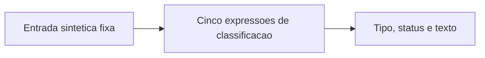

# Automation workflows

Pequenos recortes de lógica extraídos de automações reais de atendimento da Neovian. O foco deste repositório é mostrar como eventos diferentes chegam a um contrato de conteúdo previsível antes de entrarem em um fluxo maior.

Os dois exemplos são derivados do node `Dados` dos workflows de WhatsApp/Evolution e Instagram DM. Eles classificam conteúdo em memória e podem ser estudados sem conexão com serviços externos.

| Exemplo | O que demonstra |
| --- | --- |
| [WhatsApp](src/whatsapp-content.mjs) | Precedência dos campos de texto, classificação por tipo/MIME e distinção entre conteúdo e eventos de status. |
| [Instagram](src/instagram-content.mjs) | Classificação de mensagem, leitura, entrega, exclusão, echo e primeiro anexo. |

## Executar localmente

É necessário Node.js. A validação desta versão foi realizada com Node 24.14.1. Não há dependências para instalar.

```sh
npm test
npm run validate
```

Os testes usam [18 fixtures inteiramente sintéticas](fixtures/content-cases.json). A validação adicional faz o parse dos JSONs, confere as referências entre nodes e executa o código dos exemplos em memória, comparando o resultado esperado.

## Exemplos no formato n8n

- [Classificação WhatsApp](examples/whatsapp-content.json)
- [Classificação Instagram](examples/instagram-content.json)

Cada exemplo tem um gatilho manual e um Code node com uma entrada sintética fixa. Estão inativos e não contêm destinos, autenticação, integrações de envio, consultas ou escritas. Os identificadores dos dois nodes são locais e foram criados apenas para esta demonstração.



## O que estes recortes preservam

Os resultados são uma projeção de cinco campos: `event_type`, `is_status_event`, `text`, `message_type` e `message_status`. As funções não retornam o envelope recebido nem resolvem identidade.

Algumas limitações fazem parte do comportamento observado e aparecem nos testes: o Instagram examina somente `entry[0].messaging[0]`; no WhatsApp, um objeto `imageMessage` isolado, sem MIME ou tipo compatível, continua como `unknown`. O exemplo não mascara esses limites como cobertura completa do provedor.

Esta é uma demonstração de expressões, sem a coerção de tipos do Set node original. Em particular, `is_status_event` é apresentado como booleano. Isso não reproduz os gates completos de continuidade ou envio do atendimento.

Veja [derivação e escopo](docs/derivation.md) para saber como os exemplos se relacionam com os workflows privados. A validação aqui é offline; não foi realizada importação nem execução em uma instância n8n.
